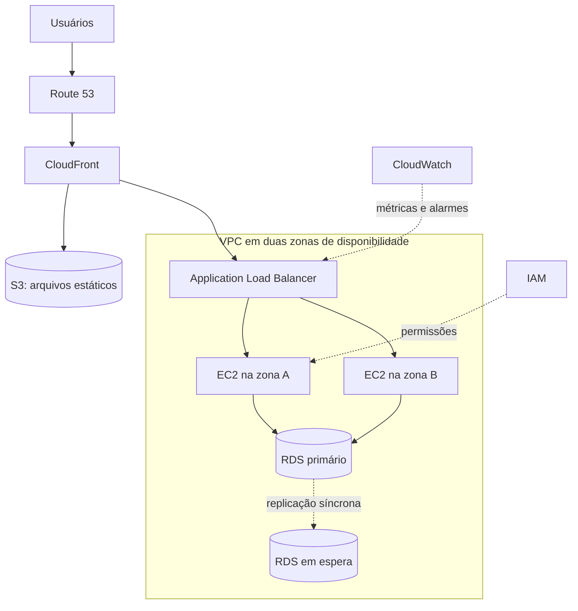

# Laboratório 01: arquitetura e os seis pilares do Well-Architected

Módulo 1. Serviço: AWS Well-Architected Tool. Custo: zero, porque a ferramenta é gratuita e o laboratório não cria infraestrutura.

## Objetivo

Ler o desenho de uma aplicação web de três camadas, apontar onde cada pilar do Well-Architected Framework aparece nela e registrar a revisão na Well-Architected Tool.

## Arquitetura



As instâncias EC2 ficam em um grupo de Auto Scaling, e o RDS usa Multi-AZ.

## Os seis pilares no desenho

| Pilar | Pergunta que ele faz | Onde aparece |
|-------|----------------------|--------------|
| Excelência operacional | Como operar e melhorar o sistema? | CloudWatch com métricas e alarmes; infraestrutura criada por código |
| Segurança | Quem acessa o quê, e como os dados são protegidos? | IAM com menor privilégio; EC2 e RDS em sub-redes privadas; HTTPS no CloudFront |
| Confiabilidade | O que acontece quando algo falha? | Duas zonas, verificação de saúde no load balancer, RDS Multi-AZ |
| Eficiência de performance | Cada recurso tem o tamanho certo? | CloudFront perto do usuário; Auto Scaling ajusta a quantidade de instâncias |
| Otimização de custos | Estamos pagando só pelo necessário? | Auto Scaling reduz as instâncias de madrugada; arquivos estáticos no S3 |
| Sustentabilidade | Qual é o impacto ambiental? | Menos instâncias ociosas e mais serviços gerenciados |

## Pelo Console

1. Abra o serviço AWS Well-Architected Tool na região `us-east-1`.
2. Clique em Define workload e preencha nome (`clf-c02-site-tres-camadas`), descrição, ambiente Pre-production e a região.
3. Mantenha a lente AWS Well-Architected Framework.
4. Clique em Start reviewing e responda pelo menos uma pergunta de cada pilar, pensando no desenho acima.
5. Salve e abra a aba Overview para ver os riscos altos e médios.
6. Em Improvement plan, leia o que a ferramenta recomenda para os riscos encontrados.

## Pela AWS CLI

Crie a carga de trabalho. Troque o e-mail pelo seu.

```bash
export AWS_DEFAULT_REGION=us-east-1

WORKLOAD_ID=$(aws wellarchitected create-workload \
  --workload-name "clf-c02-site-tres-camadas" \
  --description "Laboratorio 01: revisao dos seis pilares" \
  --environment PREPRODUCTION \
  --aws-regions us-east-1 \
  --lenses wellarchitected \
  --review-owner "seu-email@exemplo.com" \
  --tags projeto=clf-c02 \
  --query WorkloadId --output text)
echo "$WORKLOAD_ID"
```

Liste os pilares da revisão e as perguntas de um deles. Os identificadores dos pilares são `operationalExcellence`, `security`, `reliability`, `performance`, `costOptimization` e `sustainability`.

```bash
aws wellarchitected get-lens-review \
  --workload-id "$WORKLOAD_ID" --lens-alias wellarchitected \
  --query 'LensReview.PillarReviewSummaries[].PillarName' --output table

aws wellarchitected list-answers \
  --workload-id "$WORKLOAD_ID" --lens-alias wellarchitected \
  --pillar-id costOptimization \
  --query 'AnswerSummaries[].[QuestionId,QuestionTitle]' --output table
```

## Minha análise

Preencha depois de responder às perguntas na ferramenta.

| Pilar | Risco que encontrei | O que eu mudaria no desenho |
|-------|---------------------|-----------------------------|
| Excelência operacional | | |
| Segurança | | |
| Confiabilidade | | |
| Eficiência de performance | | |
| Otimização de custos | | |
| Sustentabilidade | | |

## Limpeza

A carga de trabalho não gera custo, mas apague para manter a conta sem sobras.

```bash
aws wellarchitected delete-workload --workload-id "$WORKLOAD_ID"
```

Confira que a lista voltou vazia:

```bash
aws wellarchitected list-workloads \
  --query "WorkloadSummaries[?WorkloadName=='clf-c02-site-tres-camadas'].WorkloadId"
```

## O que cai na prova

- Os nomes dos seis pilares e o assunto de cada um.
- A Well-Architected Tool é gratuita e só revisa: ela não altera nenhum recurso.
- Trusted Advisor verifica a conta automaticamente. A Well-Architected Tool depende das suas respostas.
