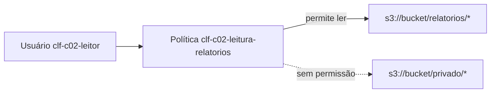

# Laboratório 02: políticas IAM em JSON

Módulo 2. Serviços: IAM e S3. Custo: zero. O IAM é gratuito e os dois arquivos de teste somam alguns bytes no S3.

## Objetivo

Escrever uma política de menor privilégio, anexar a um usuário e provar com o simulador do IAM que ele lê uma pasta do bucket e não consegue mais nada.

## Arquitetura



## A política

O arquivo [politica-menor-privilegio.json](politica-menor-privilegio.json) tem três declarações.

| Sid | Efeito | O que faz |
|-----|--------|-----------|
| `ListarSomenteAPastaRelatorios` | Allow | Lista o bucket, mas só o que começa com `relatorios/` |
| `LerObjetosDaPastaRelatorios` | Allow | Baixa objetos dessa pasta |
| `NegarAcessoSemTLS` | Deny | Recusa qualquer chamada feita sem HTTPS |

Gravar, apagar e ler a pasta `privado/` não aparecem na política, então ficam negados por padrão. `NOME-DO-BUCKET` é trocado pelo nome real no passo da CLI.

## Pelo Console

1. Em S3, crie um bucket e envie um arquivo para `relatorios/` e outro para `privado/`.
2. Em IAM > Policies > Create policy, abra a aba JSON e cole o conteúdo do arquivo, com o nome do seu bucket.
3. Em IAM > Users > Create user, crie `clf-c02-leitor` sem acesso ao Console.
4. Na aba Permissions do usuário, anexe a política.
5. Abra o [simulador de políticas](https://policysim.aws.amazon.com/), escolha o usuário, o serviço S3 e as ações `GetObject` e `PutObject`, informe o ARN de um objeto e rode a simulação.

## Pela AWS CLI

Crie o bucket e os dois arquivos de teste.

```bash
export AWS_DEFAULT_REGION=us-east-1
ACCOUNT_ID=$(aws sts get-caller-identity --query Account --output text)
BUCKET="clf-c02-iam-$ACCOUNT_ID"
USUARIO="clf-c02-leitor"

aws s3api create-bucket --bucket "$BUCKET"
echo "relatorio de teste" > /tmp/relatorio.txt
aws s3 cp /tmp/relatorio.txt "s3://$BUCKET/relatorios/relatorio.txt"
aws s3 cp /tmp/relatorio.txt "s3://$BUCKET/privado/segredo.txt"
```

Gere a política com o nome do bucket, crie o usuário e anexe.

```bash
sed "s/NOME-DO-BUCKET/$BUCKET/g" politica-menor-privilegio.json > /tmp/politica-gerada.json

POLICY_ARN=$(aws iam create-policy \
  --policy-name clf-c02-leitura-relatorios \
  --policy-document file:///tmp/politica-gerada.json \
  --tags Key=projeto,Value=clf-c02 \
  --query Policy.Arn --output text)

aws iam create-user --user-name "$USUARIO" --tags Key=projeto,Value=clf-c02
aws iam attach-user-policy --user-name "$USUARIO" --policy-arn "$POLICY_ARN"
```

Teste com o simulador. O usuário não recebe chave de acesso, então nenhuma credencial nova fica na sua máquina.

```bash
aws iam simulate-principal-policy \
  --policy-source-arn "arn:aws:iam::$ACCOUNT_ID:user/$USUARIO" \
  --action-names s3:GetObject s3:PutObject s3:DeleteObject \
  --resource-arns "arn:aws:s3:::$BUCKET/relatorios/relatorio.txt" \
  --context-entries ContextKeyName=aws:SecureTransport,ContextKeyValues=true,ContextKeyType=boolean \
  --query 'EvaluationResults[].[EvalActionName,EvalDecision]' --output table

aws iam simulate-principal-policy \
  --policy-source-arn "arn:aws:iam::$ACCOUNT_ID:user/$USUARIO" \
  --action-names s3:GetObject \
  --resource-arns "arn:aws:s3:::$BUCKET/privado/segredo.txt" \
  --context-entries ContextKeyName=aws:SecureTransport,ContextKeyValues=true,ContextKeyType=boolean \
  --query 'EvaluationResults[].[EvalActionName,EvalDecision]' --output table
```

O resultado esperado:

| Ação | Recurso | Decisão |
|------|---------|---------|
| `s3:GetObject` | `relatorios/relatorio.txt` | `allowed` |
| `s3:PutObject` | `relatorios/relatorio.txt` | `implicitDeny` |
| `s3:DeleteObject` | `relatorios/relatorio.txt` | `implicitDeny` |
| `s3:GetObject` | `privado/segredo.txt` | `implicitDeny` |

Troque `ContextKeyValues=true` por `false` na primeira simulação e o `GetObject` passa a `explicitDeny`: a declaração `NegarAcessoSemTLS` vence a permissão.

O IAM Access Analyzer revisa a política e aponta erros e permissões amplas demais. Uma lista vazia quer dizer que ele não encontrou nada.

```bash
aws accessanalyzer validate-policy \
  --policy-type IDENTITY_POLICY \
  --policy-document file:///tmp/politica-gerada.json \
  --query 'findings[].[findingType,issueCode]' --output table
```

## Limpeza

```bash
aws iam detach-user-policy --user-name "$USUARIO" --policy-arn "$POLICY_ARN"
aws iam delete-user --user-name "$USUARIO"
aws iam delete-policy --policy-arn "$POLICY_ARN"
aws s3 rb "s3://$BUCKET" --force
rm -f /tmp/relatorio.txt /tmp/politica-gerada.json
```

Confira. As duas consultas devem devolver uma lista vazia.

```bash
aws iam list-users --query "Users[?UserName=='$USUARIO'].UserName"
aws s3api list-buckets --query "Buckets[?Name=='$BUCKET'].Name"
```

## O que cai na prova

- Menor privilégio: conceder só o que a tarefa exige.
- A negação explícita vence qualquer permissão, e o que não foi permitido fica negado.
- Uma política tem `Effect`, `Action`, `Resource` e, quando preciso, `Condition`.
- Para um serviço da AWS acessar outro, usa-se função (role), nunca chave de acesso dentro do código.
