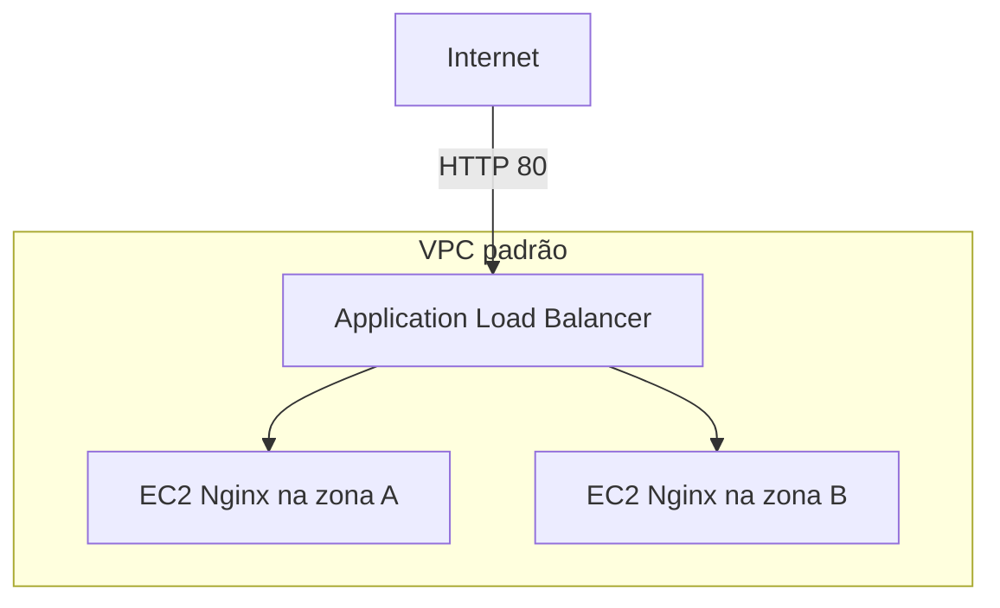

# Laboratório 03: EC2 com Application Load Balancer

Módulo 3. Serviços: EC2, Elastic Load Balancing e security groups.

## Objetivo

Subir dois servidores web Nginx em zonas de disponibilidade diferentes e colocar um Application Load Balancer na frente, para ver as respostas se alternarem entre eles.

## Arquitetura



As instâncias só aceitam tráfego vindo do security group do load balancer. A porta 22 fica fechada: quem instala o Nginx é o [user-data.sh](user-data.sh), que roda na primeira inicialização.

## Custo e Free Tier

Este é o laboratório mais caro do repositório. Apague tudo no mesmo dia.

| Recurso | Conta anterior a 15/07/2025, nos 12 primeiros meses | Demais contas |
|---------|------------------------------------------------------|---------------|
| 2 instâncias `t3.micro` | Dentro das 750 horas por mês | US$ 0,021 por hora as duas |
| Application Load Balancer | Dentro das 750 horas por mês | US$ 0,0225 por hora |
| 2 IPv4 públicos das instâncias | Dentro das 750 horas por mês | US$ 0,01 por hora |
| 2 IPv4 públicos do load balancer | Até US$ 0,01 por hora | US$ 0,01 por hora |

No pior caso são cerca de US$ 0,07 por hora ligado, pagos com os créditos nas contas novas. Para ver quais tipos de instância são gratuitos na sua conta:

```bash
export AWS_DEFAULT_REGION=us-east-1
aws ec2 describe-instance-types \
  --filters Name=free-tier-eligible,Values=true \
  --query 'InstanceTypes[].InstanceType' --output text
```

## Pelo Console

1. Em EC2 > Security Groups, crie `clf-c02-alb` liberando HTTP 80 para `0.0.0.0/0`, e `clf-c02-web` liberando HTTP 80 só para o security group `clf-c02-alb`.
2. Em EC2 > Launch instances, escolha Amazon Linux 2023, tipo `t3.micro`, sem par de chaves, o security group `clf-c02-web` e, em Advanced details > User data, cole o conteúdo do `user-data.sh`. Crie uma instância em cada zona.
3. Em EC2 > Target Groups, crie `clf-c02-web` do tipo Instances, protocolo HTTP 80, e registre as duas instâncias.
4. Em EC2 > Load Balancers, crie um Application Load Balancer voltado para a internet, em duas sub-redes, com o security group `clf-c02-alb` e um listener HTTP 80 apontando para o target group.
5. Quando os destinos ficarem `healthy`, abra o nome DNS do load balancer no navegador e recarregue algumas vezes.

## Pela AWS CLI

Descubra a rede padrão e a imagem mais recente do Amazon Linux 2023.

```bash
VPC_ID=$(aws ec2 describe-vpcs --filters Name=is-default,Values=true \
  --query 'Vpcs[0].VpcId' --output text)
SUBNET_A=$(aws ec2 describe-subnets \
  --filters Name=vpc-id,Values="$VPC_ID" Name=default-for-az,Values=true \
  --query 'Subnets[0].SubnetId' --output text)
SUBNET_B=$(aws ec2 describe-subnets \
  --filters Name=vpc-id,Values="$VPC_ID" Name=default-for-az,Values=true \
  --query 'Subnets[1].SubnetId' --output text)
AMI_ID=$(aws ssm get-parameter \
  --name /aws/service/ami-amazon-linux-latest/al2023-ami-kernel-default-x86_64 \
  --query Parameter.Value --output text)
echo "$VPC_ID $SUBNET_A $SUBNET_B $AMI_ID"
```

Crie os dois security groups.

```bash
SG_ALB=$(aws ec2 create-security-group --group-name clf-c02-alb \
  --description "Lab 03: HTTP da internet para o ALB" --vpc-id "$VPC_ID" \
  --tag-specifications 'ResourceType=security-group,Tags=[{Key=projeto,Value=clf-c02}]' \
  --query GroupId --output text)
aws ec2 authorize-security-group-ingress --group-id "$SG_ALB" \
  --protocol tcp --port 80 --cidr 0.0.0.0/0

SG_WEB=$(aws ec2 create-security-group --group-name clf-c02-web \
  --description "Lab 03: HTTP somente a partir do ALB" --vpc-id "$VPC_ID" \
  --tag-specifications 'ResourceType=security-group,Tags=[{Key=projeto,Value=clf-c02}]' \
  --query GroupId --output text)
aws ec2 authorize-security-group-ingress --group-id "$SG_WEB" \
  --protocol tcp --port 80 --source-group "$SG_ALB"
```

Suba uma instância em cada sub-rede. Rode o comando dentro desta pasta, por causa do `file://user-data.sh`.

```bash
I1=$(aws ec2 run-instances --image-id "$AMI_ID" --instance-type t3.micro \
  --subnet-id "$SUBNET_A" --security-group-ids "$SG_WEB" \
  --user-data file://user-data.sh --metadata-options HttpTokens=required \
  --tag-specifications 'ResourceType=instance,Tags=[{Key=projeto,Value=clf-c02},{Key=Name,Value=clf-c02-web-a}]' \
  --query 'Instances[0].InstanceId' --output text)
I2=$(aws ec2 run-instances --image-id "$AMI_ID" --instance-type t3.micro \
  --subnet-id "$SUBNET_B" --security-group-ids "$SG_WEB" \
  --user-data file://user-data.sh --metadata-options HttpTokens=required \
  --tag-specifications 'ResourceType=instance,Tags=[{Key=projeto,Value=clf-c02},{Key=Name,Value=clf-c02-web-b}]' \
  --query 'Instances[0].InstanceId' --output text)
aws ec2 wait instance-status-ok --instance-ids "$I1" "$I2"
```

Crie o target group, o load balancer e o listener. A espera pelos destinos saudáveis leva de dois a três minutos.

```bash
TG_ARN=$(aws elbv2 create-target-group --name clf-c02-web \
  --protocol HTTP --port 80 --vpc-id "$VPC_ID" --target-type instance \
  --health-check-path / --tags Key=projeto,Value=clf-c02 \
  --query 'TargetGroups[0].TargetGroupArn' --output text)
aws elbv2 register-targets --target-group-arn "$TG_ARN" \
  --targets Id="$I1" Id="$I2"

ALB_ARN=$(aws elbv2 create-load-balancer --name clf-c02-alb \
  --type application --scheme internet-facing \
  --subnets "$SUBNET_A" "$SUBNET_B" --security-groups "$SG_ALB" \
  --tags Key=projeto,Value=clf-c02 \
  --query 'LoadBalancers[0].LoadBalancerArn' --output text)
aws elbv2 create-listener --load-balancer-arn "$ALB_ARN" \
  --protocol HTTP --port 80 \
  --default-actions Type=forward,TargetGroupArn="$TG_ARN"

aws elbv2 wait load-balancer-available --load-balancer-arns "$ALB_ARN"
aws elbv2 wait target-in-service --target-group-arn "$TG_ARN"
```

Teste. Os identificadores das duas instâncias devem se alternar.

```bash
ALB_DNS=$(aws elbv2 describe-load-balancers --load-balancer-arns "$ALB_ARN" \
  --query 'LoadBalancers[0].DNSName' --output text)
for tentativa in 1 2 3 4 5 6; do
  curl -s "http://$ALB_DNS" | grep -o 'i-[0-9a-f]*'
done
```

Para ver a alta disponibilidade funcionando, pare uma instância com `aws ec2 stop-instances --instance-ids "$I1"`, espere um minuto e repita o teste: todas as respostas passam a vir da outra.

## Limpeza

A ordem importa: primeiro o load balancer, depois o target group, as instâncias e por último os security groups.

```bash
aws elbv2 delete-load-balancer --load-balancer-arn "$ALB_ARN"
aws elbv2 wait load-balancers-deleted --load-balancer-arns "$ALB_ARN"
aws elbv2 delete-target-group --target-group-arn "$TG_ARN"
aws ec2 terminate-instances --instance-ids "$I1" "$I2"
aws ec2 wait instance-terminated --instance-ids "$I1" "$I2"
aws ec2 delete-security-group --group-id "$SG_WEB"
aws ec2 delete-security-group --group-id "$SG_ALB"
```

Se o último comando responder `DependencyViolation`, as interfaces de rede do load balancer ainda estão sendo liberadas. Espere um minuto e repita.

Confira. As três consultas devem devolver uma lista vazia.

```bash
aws ec2 describe-instances \
  --filters Name=tag:projeto,Values=clf-c02 Name=instance-state-name,Values=pending,running,stopping,stopped \
  --query 'Reservations[].Instances[].InstanceId'
aws elbv2 describe-load-balancers \
  --query "LoadBalancers[?LoadBalancerName=='clf-c02-alb'].LoadBalancerName"
aws ec2 describe-security-groups \
  --filters Name=group-name,Values=clf-c02-alb,clf-c02-web \
  --query 'SecurityGroups[].GroupName'
```

## O que cai na prova

- Application Load Balancer trabalha com HTTP e HTTPS. Network Load Balancer trabalha com TCP e UDP.
- Distribuir instâncias em mais de uma zona dá alta disponibilidade.
- O load balancer só envia tráfego para destinos que passam na verificação de saúde.
- Security group tem estado e só tem regra de permissão.
