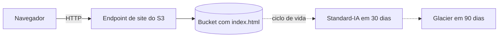

# Laboratório 04: site estático no S3

Módulo 4. Serviço: S3. Custo: zero na prática, porque o site ocupa menos de 1 KB.

## Objetivo

Publicar uma página HTML direto de um bucket e aplicar uma regra de ciclo de vida que move arquivos antigos para classes mais baratas.

## Arquitetura



## Os arquivos

| Arquivo | O que é |
|---------|---------|
| [index.html](index.html) | A página publicada |
| [lifecycle-policy.json](lifecycle-policy.json) | Duas regras de ciclo de vida |

A primeira regra vale para o prefixo `logs/`: move para Standard-IA em 30 dias, para Glacier Flexible Retrieval em 90 e apaga em 365. A segunda apaga, depois de 7 dias, os envios em partes que ficaram pela metade e que continuam sendo cobrados sem aparecer na listagem do bucket.

## Aviso sobre acesso público

O bucket deste laboratório fica público para leitura. Coloque nele só o `index.html` e apague ao terminar. Em uso real, o bucket continua privado e quem entrega o site é o CloudFront.

## Pelo Console

1. Em S3 > Create bucket, crie um bucket em `us-east-1` e desmarque Block all public access, confirmando o aviso.
2. Envie o `index.html`.
3. Na aba Properties, ative Static website hosting com `index.html` como documento de índice.
4. Na aba Permissions, cole em Bucket policy a política de leitura pública mostrada no passo da CLI.
5. Na aba Management, crie as regras de ciclo de vida conforme o `lifecycle-policy.json`.
6. Abra o endereço mostrado em Static website hosting.

## Pela AWS CLI

Crie o bucket e ative a hospedagem. Em outra região, acrescente `--create-bucket-configuration LocationConstraint=<região>` ao `create-bucket`.

```bash
export AWS_DEFAULT_REGION=us-east-1
ACCOUNT_ID=$(aws sts get-caller-identity --query Account --output text)
BUCKET="clf-c02-site-$ACCOUNT_ID"

aws s3api create-bucket --bucket "$BUCKET"
aws s3api put-bucket-tagging --bucket "$BUCKET" \
  --tagging 'TagSet=[{Key=projeto,Value=clf-c02}]'
aws s3 website "s3://$BUCKET" --index-document index.html --error-document index.html
```

Libere a leitura pública. O bloqueio de ACLs continua ligado; só a política de bucket passa a ser aceita.

```bash
aws s3api put-public-access-block --bucket "$BUCKET" \
  --public-access-block-configuration \
  BlockPublicAcls=true,IgnorePublicAcls=true,BlockPublicPolicy=false,RestrictPublicBuckets=false

cat > /tmp/politica-site.json <<EOF
{
  "Version": "2012-10-17",
  "Statement": [
    {
      "Sid": "LeituraPublicaDoSite",
      "Effect": "Allow",
      "Principal": "*",
      "Action": "s3:GetObject",
      "Resource": "arn:aws:s3:::$BUCKET/*"
    }
  ]
}
EOF
aws s3api put-bucket-policy --bucket "$BUCKET" --policy file:///tmp/politica-site.json
```

Se o `put-bucket-policy` responder `AccessDenied`, o bloqueio de acesso público está ligado para a conta inteira. Ele fica em S3 > Block Public Access settings for this account.

Envie a página, aplique o ciclo de vida e teste.

```bash
aws s3 cp index.html "s3://$BUCKET/index.html" --content-type "text/html; charset=utf-8"
aws s3api put-bucket-lifecycle-configuration --bucket "$BUCKET" \
  --lifecycle-configuration file://lifecycle-policy.json
aws s3api get-bucket-lifecycle-configuration --bucket "$BUCKET" \
  --query 'Rules[].[ID,Status]' --output table

SITE="http://$BUCKET.s3-website-us-east-1.amazonaws.com"
echo "$SITE"
curl -s "$SITE" | grep -o '<h1>.*</h1>'
```

## Limpeza

```bash
aws s3 rb "s3://$BUCKET" --force
rm -f /tmp/politica-site.json
```

Confira. A consulta deve devolver uma lista vazia.

```bash
aws s3api list-buckets --query "Buckets[?Name=='$BUCKET'].Name"
```

## O que cai na prova

- O S3 hospeda site estático: HTML, CSS, JavaScript e imagens. Código de servidor, como PHP, não roda nele.
- Bucket novo nasce privado, com o Block Public Access ligado.
- O ciclo de vida automatiza a troca de classe e a exclusão.
- O endpoint de site do S3 só atende HTTP. Para HTTPS, coloca-se o CloudFront na frente.
