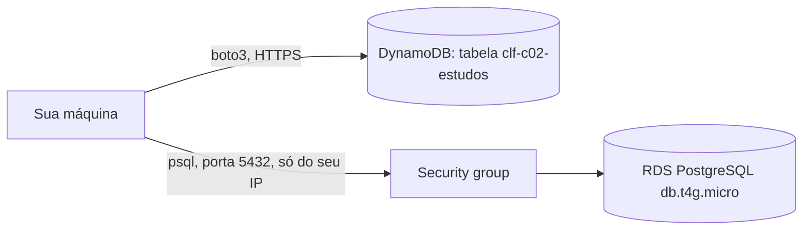

# Laboratório 05: RDS e DynamoDB com Python

Módulo 5. Serviços: DynamoDB e RDS.

## Objetivo

Usar um banco NoSQL e um relacional no mesmo dia para sentir a diferença: no DynamoDB, um script Python com `boto3` cria a tabela e faz as operações; no RDS, você sobe um PostgreSQL gerenciado e conecta com o `psql`.

## Arquitetura



## Custo e Free Tier

| Recurso | Regra | Custo |
|---------|-------|-------|
| Tabela DynamoDB provisionada com 5/5 | Free Tier sem prazo: 25 GB e 25 unidades de leitura e de escrita | Zero |
| RDS `db.t4g.micro`, 20 GB, uma zona | Conta anterior a 15/07/2025, nos 12 primeiros meses: 750 horas por mês | Zero |
| RDS `db.t4g.micro`, 20 GB, uma zona | Demais contas | Cerca de US$ 0,02 por hora, pagos com os créditos |
| IPv4 público do RDS | Todas as contas | Até US$ 0,005 por hora |

O RDS cobra por hora mesmo sem conexões, e uma instância parada volta a ligar sozinha depois de 7 dias. Apague no fim do laboratório.

## Parte 1: DynamoDB com boto3

O [app.py](app.py) cria a tabela `clf-c02-estudos`, com `modulo` como chave de partição e `aula` como chave de ordenação. Depois grava, lê, atualiza, consulta e apaga itens, conferindo cada resultado.

### Pelo Console

1. Em DynamoDB > Tables > Create table, crie `clf-c02-estudos` com chave de partição `modulo` (String) e chave de ordenação `aula` (Number).
2. Em Table settings, escolha Customize settings, modo Provisioned, com 5 unidades de leitura e 5 de escrita, sem Auto Scaling.
3. Em Explore table items, crie um item, edite e apague.

### Pela AWS CLI e Python

```bash
export AWS_DEFAULT_REGION=us-east-1
python3 -m venv .venv
. .venv/bin/activate
pip install --quiet boto3
python app.py
```

Confira a tabela pela CLI:

```bash
aws dynamodb describe-table --table-name clf-c02-estudos \
  --query 'Table.[TableName,TableStatus,ProvisionedThroughput.ReadCapacityUnits]' --output table
aws dynamodb scan --table-name clf-c02-estudos --query 'Items'
```

## Parte 2: RDS PostgreSQL

### Pelo Console

1. Em RDS > Create database, escolha Standard create, PostgreSQL e o modelo Free tier, se ele aparecer para a sua conta.
2. Use o identificador `clf-c02-postgres`, a classe `db.t4g.micro`, 20 GB de armazenamento e uma zona só.
3. Em Connectivity, marque Public access e crie um security group que libere a porta 5432 só para o seu IP.
4. Em Additional configuration, desative os backups automáticos.
5. Quando o status ficar Available, copie o endpoint e conecte com o `psql`.

### Pela AWS CLI

Crie um security group que só aceita o seu IP.

```bash
VPC_ID=$(aws ec2 describe-vpcs --filters Name=is-default,Values=true \
  --query 'Vpcs[0].VpcId' --output text)
MEU_IP=$(curl -s https://checkip.amazonaws.com)

SG_RDS=$(aws ec2 create-security-group --group-name clf-c02-rds \
  --description "Lab 05: PostgreSQL somente do meu IP" --vpc-id "$VPC_ID" \
  --tag-specifications 'ResourceType=security-group,Tags=[{Key=projeto,Value=clf-c02}]' \
  --query GroupId --output text)
aws ec2 authorize-security-group-ingress --group-id "$SG_RDS" \
  --protocol tcp --port 5432 --cidr "$MEU_IP/32"
```

Crie o banco. A senha é gerada na hora e fica só na variável do terminal. A espera leva de 5 a 10 minutos.

```bash
DB_SENHA=$(openssl rand -hex 16)

aws rds create-db-instance \
  --db-instance-identifier clf-c02-postgres \
  --engine postgres \
  --db-instance-class db.t4g.micro \
  --allocated-storage 20 \
  --storage-type gp2 \
  --master-username estudante \
  --master-user-password "$DB_SENHA" \
  --vpc-security-group-ids "$SG_RDS" \
  --publicly-accessible \
  --no-multi-az \
  --backup-retention-period 0 \
  --tags Key=projeto,Value=clf-c02 \
  --query 'DBInstance.DBInstanceStatus' --output text

aws rds wait db-instance-available --db-instance-identifier clf-c02-postgres
```

Conecte e rode SQL. Se não tiver o `psql`, instale o pacote `postgresql-client`.

```bash
DB_HOST=$(aws rds describe-db-instances --db-instance-identifier clf-c02-postgres \
  --query 'DBInstances[0].Endpoint.Address' --output text)

PGPASSWORD="$DB_SENHA" psql "host=$DB_HOST port=5432 dbname=postgres user=estudante sslmode=require" \
  -c "create table aulas (modulo text, aula int, titulo text, primary key (modulo, aula));" \
  -c "insert into aulas values ('mod-05', 24, 'RDS e Aurora'), ('mod-05', 25, 'DynamoDB');" \
  -c "select * from aulas order by aula;"
```

Se a conexão não responder, o seu IP mudou desde a criação do security group. Rode de novo o `curl` do IP e o `authorize-security-group-ingress`.

## DynamoDB e RDS lado a lado

| | DynamoDB | RDS |
|---|----------|-----|
| Modelo | Chave-valor, sem esquema fixo | Relacional, com tabelas e SQL |
| Servidor | Não existe instância | Você escolhe a classe da instância |
| Acesso | API HTTPS com credencial IAM | Conexão de rede com usuário e senha do banco |
| Ficou pronto em | Segundos | Minutos |

## Limpeza

```bash
aws rds delete-db-instance --db-instance-identifier clf-c02-postgres \
  --skip-final-snapshot --delete-automated-backups \
  --query 'DBInstance.DBInstanceStatus' --output text
aws rds wait db-instance-deleted --db-instance-identifier clf-c02-postgres
aws ec2 delete-security-group --group-id "$SG_RDS"

python app.py --cleanup
deactivate
rm -rf .venv
```

Confira. As quatro consultas devem devolver uma lista vazia.

```bash
aws rds describe-db-instances \
  --query "DBInstances[?DBInstanceIdentifier=='clf-c02-postgres'].DBInstanceStatus"
aws rds describe-db-snapshots \
  --query "DBSnapshots[?DBInstanceIdentifier=='clf-c02-postgres'].DBSnapshotIdentifier"
aws dynamodb list-tables --query "TableNames[?@=='clf-c02-estudos']"
aws ec2 describe-security-groups --filters Name=group-name,Values=clf-c02-rds \
  --query 'SecurityGroups[].GroupName'
```

## O que cai na prova

- RDS é relacional e gerenciado: a AWS faz backup e atualização, e você escolhe a instância.
- DynamoDB é NoSQL e serverless, com resposta em milissegundos.
- Multi-AZ no RDS serve para disponibilidade. Réplica de leitura serve para performance.
- No modelo de responsabilidade compartilhada, quem libera o acesso de rede ao banco é você.
