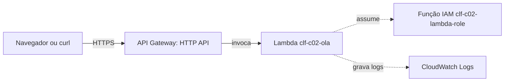

# Laboratório 06: Lambda com API Gateway

Módulo 6. Serviços: Lambda, API Gateway e IAM. Custo: zero. A Lambda tem 1 milhão de requisições gratuitas por mês sem prazo, e uma HTTP API custa US$ 1,00 por milhão de chamadas fora do Free Tier.

## Objetivo

Publicar uma função Python e chamá-la por uma URL pública, sem criar nenhum servidor.

## Arquitetura



## O código

O [lambda_function.py](lambda_function.py) lê o parâmetro `nome` da URL e devolve um JSON com uma saudação, o método, o caminho e o horário. Antes de enviar para a AWS, rode o autoteste local:

```bash
python3 lambda_function.py
```

## Pelo Console

1. Em Lambda > Create function, escolha Author from scratch, o nome `clf-c02-ola` e o runtime Python 3.13. O Console cria a função IAM de execução.
2. Cole o conteúdo do `lambda_function.py` no editor e clique em Deploy.
3. Na aba Test, crie um evento com `{"queryStringParameters": {"nome": "Ana"}}` e execute.
4. Em Add trigger, escolha API Gateway, Create a new API, tipo HTTP API e segurança Open.
5. Abra o API endpoint mostrado no gatilho, acrescentando `?nome=Ana` ao final.

## Pela AWS CLI

Crie a função IAM que a Lambda assume. A política gerenciada só permite gravar logs.

```bash
export AWS_DEFAULT_REGION=us-east-1
ACCOUNT_ID=$(aws sts get-caller-identity --query Account --output text)

cat > /tmp/confianca-lambda.json <<'EOF'
{
  "Version": "2012-10-17",
  "Statement": [
    {
      "Effect": "Allow",
      "Principal": { "Service": "lambda.amazonaws.com" },
      "Action": "sts:AssumeRole"
    }
  ]
}
EOF

ROLE_ARN=$(aws iam create-role --role-name clf-c02-lambda-role \
  --assume-role-policy-document file:///tmp/confianca-lambda.json \
  --tags Key=projeto,Value=clf-c02 \
  --query Role.Arn --output text)
aws iam attach-role-policy --role-name clf-c02-lambda-role \
  --policy-arn arn:aws:iam::aws:policy/service-role/AWSLambdaBasicExecutionRole
sleep 10
```

O `sleep` dá tempo para a função IAM propagar. Sem ele, o `create-function` pode responder que a função não pode ser assumida.

Empacote e crie a função Lambda, depois teste direto, sem a API.

```bash
zip -j /tmp/funcao.zip lambda_function.py

FUNCTION_ARN=$(aws lambda create-function --function-name clf-c02-ola \
  --runtime python3.13 --handler lambda_function.lambda_handler \
  --role "$ROLE_ARN" --zip-file fileb:///tmp/funcao.zip \
  --timeout 5 --memory-size 128 --tags projeto=clf-c02 \
  --query FunctionArn --output text)
aws lambda wait function-active-v2 --function-name clf-c02-ola

aws lambda invoke --function-name clf-c02-ola \
  --cli-binary-format raw-in-base64-out \
  --payload '{"queryStringParameters":{"nome":"Ana"}}' /tmp/resposta.json
cat /tmp/resposta.json
```

Crie a HTTP API apontando para a função e autorize o API Gateway a invocá-la.

```bash
API_ID=$(aws apigatewayv2 create-api --name clf-c02-api \
  --protocol-type HTTP --target "$FUNCTION_ARN" --tags projeto=clf-c02 \
  --query ApiId --output text)

aws lambda add-permission --function-name clf-c02-ola \
  --statement-id apigateway-invoke --action lambda:InvokeFunction \
  --principal apigateway.amazonaws.com \
  --source-arn "arn:aws:execute-api:$AWS_DEFAULT_REGION:$ACCOUNT_ID:$API_ID/*" \
  --query Statement --output text

API_URL=$(aws apigatewayv2 get-api --api-id "$API_ID" --query ApiEndpoint --output text)
echo "$API_URL"
curl -s "$API_URL/?nome=Ana"
```

A URL é pública e não pede autenticação. Qualquer pessoa com o endereço consegue chamar a função, então apague ao terminar.

## Limpeza

```bash
aws apigatewayv2 delete-api --api-id "$API_ID"
aws lambda delete-function --function-name clf-c02-ola
aws iam detach-role-policy --role-name clf-c02-lambda-role \
  --policy-arn arn:aws:iam::aws:policy/service-role/AWSLambdaBasicExecutionRole
aws iam delete-role --role-name clf-c02-lambda-role
aws logs delete-log-group --log-group-name /aws/lambda/clf-c02-ola
rm -f /tmp/confianca-lambda.json /tmp/funcao.zip /tmp/resposta.json
```

Confira. As três consultas devem devolver uma lista vazia.

```bash
aws lambda list-functions --query "Functions[?FunctionName=='clf-c02-ola'].FunctionName"
aws apigatewayv2 get-apis --query "Items[?Name=='clf-c02-api'].ApiId"
aws iam list-roles --query "Roles[?RoleName=='clf-c02-lambda-role'].RoleName"
```

## O que cai na prova

- Na Lambda você paga por requisição e por tempo de execução, e não há servidor para administrar.
- Uma execução dura no máximo 15 minutos.
- A função acessa outros serviços por uma função IAM de execução.
- API Gateway com Lambda é o desenho clássico de API serverless.
- Os logs da função vão para o CloudWatch Logs.
