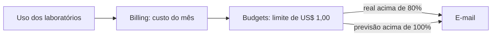

# Laboratório 07: AWS Budgets e FinOps

Módulo 7. Serviços: Budgets e Billing. Custo: zero, porque orçamentos que só enviam alerta são gratuitos.

Faça este laboratório antes de todos os outros. Ele é o único que continua ligado durante a jornada: o alerta só protege enquanto existe.

## Objetivo

Criar um orçamento mensal de US$ 1,00 que avisa por e-mail quando o gasto real passa de 80% do limite ou quando a previsão do mês passa de 100%.

## Arquitetura



## Os arquivos

| Arquivo | O que é |
|---------|---------|
| [orcamento-1-dolar.json](orcamento-1-dolar.json) | O orçamento: mensal, de custo, com limite de US$ 1,00 |
| [alertas.json](alertas.json) | Os dois alertas e o e-mail que os recebe |

No orçamento, `IncludeCredit` e `IncludeRefund` ficam em `false`. Com eles ligados, os créditos do Free Tier abatem o gasto, o total fica em zero e o alerta nunca dispara, mesmo com um recurso esquecido consumindo os créditos.

## Pelo Console

1. Entre em Billing and Cost Management > Budgets > Create budget.
2. Escolha Customize (advanced), Cost budget, período Monthly e valor fixo de 1,00.
3. Em Advanced options, desmarque Credits e Refunds.
4. Adicione um alerta em 80% do valor real e outro em 100% do valor previsto, com o seu e-mail.
5. Em Billing preferences > Alert preferences, ative Receive AWS Free Tier alerts.

## Pela AWS CLI

Troque o e-mail e crie o orçamento. O Budgets é um serviço global, com endpoint em `us-east-1`.

```bash
export AWS_DEFAULT_REGION=us-east-1
ACCOUNT_ID=$(aws sts get-caller-identity --query Account --output text)
EMAIL="seu-email@exemplo.com"

sed "s/seu-email@exemplo.com/$EMAIL/g" alertas.json > /tmp/alertas.json

aws budgets create-budget \
  --account-id "$ACCOUNT_ID" \
  --budget file://orcamento-1-dolar.json \
  --notifications-with-subscribers file:///tmp/alertas.json
rm -f /tmp/alertas.json
```

Confira o orçamento e os alertas.

```bash
aws budgets describe-budget --account-id "$ACCOUNT_ID" \
  --budget-name clf-c02-orcamento-1-dolar \
  --query 'Budget.[BudgetName,BudgetLimit.Amount,TimeUnit]' --output table

aws budgets describe-notifications-for-budget --account-id "$ACCOUNT_ID" \
  --budget-name clf-c02-orcamento-1-dolar \
  --query 'Notifications[].[NotificationType,Threshold]' --output table
```

Se a CLI responder `AccessDenied`, o seu usuário IAM não enxerga o faturamento. Entre como raiz, abra Account e ative IAM user and role access to Billing information.

## O que o orçamento não faz

- Ele avisa e não desliga nada. O recurso continua rodando até você apagar.
- Os dados de custo atualizam algumas vezes por dia, então o e-mail pode chegar horas depois do gasto.
- O alerta de previsão precisa de algumas semanas de histórico para começar a funcionar.

Por isso a limpeza no fim de cada laboratório continua obrigatória, com a conferência do README de cada um.

## Rotina semanal de FinOps

1. Abra Billing and Cost Management > Bills e confira o total do mês.
2. Abra Free Tier e veja se algum serviço passou de 85% do limite.
3. Rode a varredura por tag do [README principal](../../README.md#checklist-de-segurança-e-finops).
4. Abra o Cost Explorer agrupado por serviço. Use o Console: a API do Cost Explorer cobra US$ 0,01 por requisição.

## Limpeza

Só no fim da jornada, depois que todos os outros laboratórios estiverem apagados.

```bash
aws budgets delete-budget --account-id "$ACCOUNT_ID" \
  --budget-name clf-c02-orcamento-1-dolar
```

Confira. A consulta deve devolver uma lista vazia.

```bash
aws budgets describe-budgets --account-id "$ACCOUNT_ID" \
  --query "Budgets[?BudgetName=='clf-c02-orcamento-1-dolar'].BudgetName"
```

## O que cai na prova

- Budgets define um limite e alerta. Cost Explorer analisa o gasto passado e projeta o futuro. Pricing Calculator estima antes de criar.
- Um orçamento pode acompanhar custo, uso, cobertura ou utilização de reservas e de Savings Plans.
- Tags de alocação de custo separam o gasto por projeto.
- A fatura consolidada do Organizations soma o uso de todas as contas.
